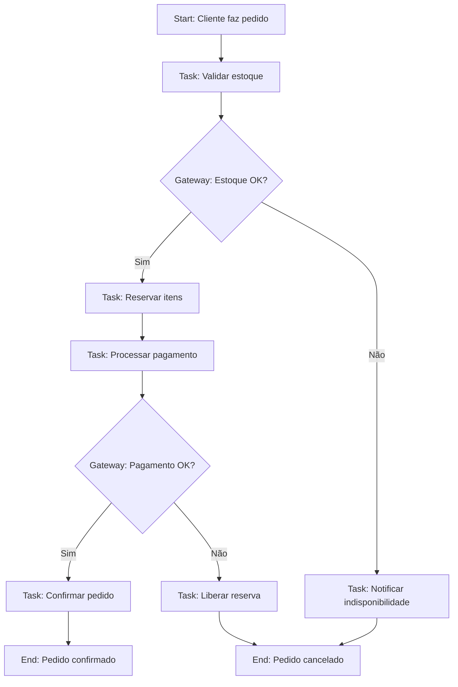

# Skill: Modelagem de Processos de Negócio

## Responsabilidade e Escopo

Competência de referência para modelagem, análise e documentação de processos de negócio. Suporta elicitação de requisitos (PO), decisões arquiteturais (ARC) e design de jornadas (UX/UI).

## Técnicas e Notações

### 1. BPMN 2.0 (Business Process Model and Notation)
#### Elementos Principais
| Elemento | Símbolo | Uso |
|---|---|---|
| **Start Event** | ⭕ (fino) | Início do processo (Message, Timer, Signal) |
| **End Event** | ⭕ (grosso) | Fim do processo (Message, Error, Terminate) |
| **Task** | ▭ (arredondado) | Unidade de trabalho atômica (User, Service, Script, Manual) |
| **Subprocess** | ▭ (com +) | Processo aninhado (Expanded/Collapsed) |
| **Gateway** | ◇ | Decisão/Controle de fluxo (Exclusive, Parallel, Inclusive, Event-based) |
| **Sequence Flow** | → (sólida) | Ordem de execução |
| **Message Flow** | → (tracejada) | Comunicação entre pools/participantes |
| **Pool/Lane** | Retângulo grande | Participante (Pool) / Responsável (Lane) |
| **Data Object** | 📄 | Entrada/saída de dados |
| **Annotation** | 📎 | Documentação complementar |

#### Padrões Comuns


### 2. Event Storming (Descoberta de Domínio)
#### Workshop Colaborativo (2-4 horas)
**Participantes**: Domain Experts (PO, Business), Devs, UX, QA

#### Saídas (Cores Padrão)
| Cor | Elemento | Descrição |
|---|---|---|
| **Laranja** | **Domain Events** | Fatos ocorridos no passado (ex: `PedidoConfirmado`, `PagamentoRecebido`) |
| **Azul** | **Commands** | Intenção de mudança de estado (ex: `ConfirmarPedido`, `CancelarPedido`) |
| **Amarelo** | **Aggregates** | Quem decide (ex: `Pedido`, `Cliente`, `Estoque`) |
| **Rosa** | **Policies/Rules** | Regras de negócio automáticas (ex: "Se valor > 1000 → Aprovação gerente") |
| **Verde** | **Read Models** | Projeções para consulta (ex: `DashboardPedidos`, `RelatorioVendas`) |
| **Roxo** | **External Systems** | Sistemas externos (ex: `GatewayPagamento`, `ERP`, `EmailService`) |
| **Branco** | **Questions/Issues** | Dúvidas, ambiguidades, decisões pendentes |

#### Fluxo do Workshop
```
1. Big Picture (30min) — Todos eventos do domínio (laranja) na timeline
2. Process Modeling (60min) — Adicionar Commands (azul) → Aggregates (amarelo)
3. Design Level (60min) — Policies (rosa), Read Models (verde), External (roxo)
4. Identificar Bounded Contexts — Agrupar por linguagem comum
5. Context Mapping — Definir relacionamentos entre contextos
```

### 3. User Journey Map (UX/UI)
#### Template
```
ETAPA           | AÇÕES DO USUÁRIO        | PENSAMENTOS/SENTIMENTOS    | PONTOS DE CONTATO      | OPORTUNIDADES/DORES
----------------|-------------------------|----------------------------|------------------------|----------------------
Descoberta      | Busca no Google         | "Será que resolve?"        | Landing, Ads           | SEO, Value prop
Consideração    | Compara alternativas    | "Preciso confiar"          | Demo, Cases, Reviews   | Trial, Depoimentos
Onboarding      | Cadastro, tutorial      | "Espero que seja fácil"    | Signup, Wizard         | Progressive disclosure
Ativação        | Primeira tarefa chave   | "Consegui!"                | Feature principal      | Success state
Retenção        | Uso recorrente          | "Faz parte da rotina"      | Dashboard, Alertas     | Personalização
Advocacia       | Indica para outros      | "Vale a pena"              | Share, NPS             | Referral program
```

### 4. Fluxogramas Simples (Decisão Rápida)
- **Decisão**: ◇ (losango)
- **Processo**: ▭ (retângulo)
- **Início/Fim**: ⭕ (elipse)
- **Documento/Dado**: 📄 (retângulo com base ondulada)
- **Conector**: ○ (círculo pequeno) para saltos de página

## Aplicação por Agente

### PO (deboaz-po) — Elicitação e Validação
- **Event Storming** com stakeholders para descobrir domínio
- **BPMN** para documentar processos atuais (as-is) e futuros (to-be)
- **User Journey** para priorizar features por valor percebido
- **Identificar regras de negócio** (Policies rosa) → Critérios Gherkin

### ARC (deboaz-arc) — Decisões Arquiteturais
- **Bounded Contexts** do Event Storming → Definir limites de microsserviços/módulos
- **Aggregates** (amarelo) → Aggregate Roots no Domain
- **Domain Events** (laranja) → Domain Events + Integração assíncrona
- **Commands** (azul) → Use Cases (Commands) na Application
- **External Systems** (roxo) → Ports Out + Adapters
- **Read Models** (verde) → Queries/Projections (CQRS)

### UX/UI (deboaz-uxui) — Design de Interfaces
- **User Journey** → Flows, Wireframes, Protótipos
- **Tasks (BPMN)** → Telas, Interações, Estados
- **Policies** → Validações, Mensagens de erro, Constraints UI
- **Pain Points (Journey)** → Oportunidades de melhoria UX

## Entregáveis Documentados

| Artefato | Formato | Localização | Versionamento |
|---|---|---|---|
| Event Storming Board | Miro/Figma/Photo | `1_Requisitos/` (link) | Imagem + Data |
| BPMN Diagrams | `.bpmn` (XML) + SVG | `2_Diagramas/` | `<nome>_v<NN>_<AAAAMMDD>.svg` |
| User Journey Maps | Figma/Miro/Markdown+SVG | `1_Requisitos/` | Versionado |
| Context Map | Markdown + Mermaid/SVG | `3_Arquitetura/` | ADR referenciado |
| Process Policies | Markdown (tabela) | `1_Requisitos/` | Junto a requisitos |

## Boas Práticas

1. **Event Storming primeiro** — Descoberta colaborativa antes de BPMN formal
2. **Linguagem Ubíqua** — Nomes dos eventos/commands/aggregates = código
3. **Uma cor, um significado** — Não inventar cores no Event Storming
4. **Bounded Contexts claros** — Fronteiras explícitas, não assumir
5. **Versionar diagramas** — SVG em `2_Diagramas/` com nomenclatura padrão
6. **Rastreabilidade** — Evento (laranja) → Gherkin Scenario → Use Case → Test

## Critérios de Qualidade

- [ ] Event Storming realizado com Domain Experts + Devs + UX + QA
- [ ] Bounded Contexts identificados e mapeados (Context Mapping)
- [ ] BPMN para processos críticos documentado e versionado
- [ ] User Journey Maps para principais personas
- [ ] Policies (regras) extraídas e transformadas em Gherkin
- [ ] Diagramas SVG versionados em `2_Diagramas/`
- [ ] Rastreabilidade: Evento → Gherkin → Código → Teste

## Referências

- `gherkin-bdd` — Policies → Cenários Gherkin
- `engenharia-requisitos` — Elicitação, especificação
- `ddd-conceitos` — Bounded Contexts, Aggregates, Events
- `arquitetura-hexagonal` — Ports/Adapters a partir de External Systems
- `ux-ui-design` — Journey → Flows → Protótipos